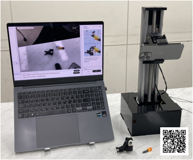
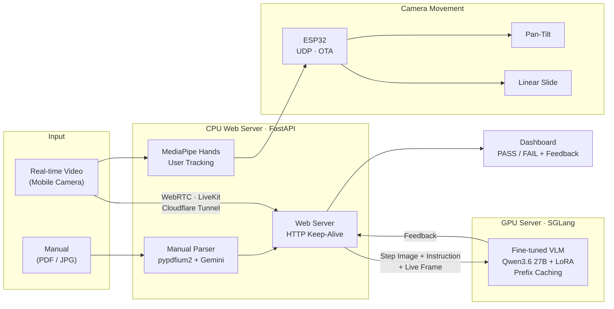

<p align="center">
  
</p>

<p align="center">
  Real-time task verification that compares a user's work against any instruction manual,<br/>
  detects mistakes, and explains what went wrong and what to do next.
</p>

<p align="center">
  
  
  
  
  
</p>

<p align="center">
  <a href="#overview">Overview</a> &nbsp;·&nbsp;
  <a href="#architecture">Architecture</a> &nbsp;·&nbsp;
  <a href="#results">Results</a> &nbsp;·&nbsp;
  <a href="#tech-stack">Tech Stack</a> &nbsp;·&nbsp;
  <a href="#getting-started">Getting Started</a> &nbsp;·&nbsp;
  <a href="#team">Team</a>
</p>

<br/>

<p align="center">
  
</p>

<br/>

## Overview

Nunchi Coach turns an uploaded manual (PDF or image) into structured, step-level instructions. A fine-tuned Vision-Language Model then compares each step against a live camera feed and returns a **PASS / FAIL** verdict along with corrective feedback.

Because judgment is grounded in the manual rather than in task-specific training, the same system applies to assembly kits, repair work, or any other procedural task simply by swapping the manual. A hand-tracking camera rig (MediaPipe + ESP32-driven pan-tilt and linear slide) keeps the work area in frame throughout.

| | Conventional approach | Nunchi Coach |
|:--|:--|:--|
| **Feedback** | One-way printed or video manuals | Real-time explanation of the error and the next action |
| **Generality** | Criteria must be redefined for every task | No retraining required; replace the manual |
| **Field of view** | Fixed camera with blind spots | Active camera that follows the user's hands |

<br/>

## Motivation

- In training and industrial settings, a single instructor cannot verify every trainee's work.
- Printed and video manuals do not tell the user what was done incorrectly.
- Existing coaching systems require new evaluation criteria for each new task.

<br/>

## Architecture



<details>
<summary><b>Component details</b></summary>
<br/>

| Layer | Component | Role |
|:--|:--|:--|
| Mobile | Camera | Streams the work area to the web server over WebRTC (LiveKit) |
| Browser | Dashboard, QR, Uploader | Displays feedback, connects the mobile camera via QR code, uploads manuals |
| CPU Server | Manual Parser | Renders PDF pages with `pypdfium2` (200 DPI, cross-platform) and calls Gemini in parallel to extract step images, instructions, and sub-steps |
| | MediaPipe | Tracks hand landmarks and issues camera control signals when the hand leaves the central 80% deadzone |
| | Web Server | Reuses a global `AsyncClient` (keep-alive) for low-latency requests to the GPU server |
| GPU Server | Fine-tuned VLM | Compares the reference step image, instruction, and live frame to produce a verdict and feedback |
| Hardware | ESP32 | Receives target coordinates over UDP; firmware updated via OTA |
| | Pan-Tilt | Servo-driven horizontal and vertical rotation for hand tracking |
| | Linear Slide | Stepper motor (6400 pulse/rev, 1.5 A) with limit switches for vertical travel |

**Hierarchical prefix caching**

| Level | Content | Update frequency |
|:--:|:--|:--|
| L1 | System prompt (persona, judgment rules, output format) | Fixed for the session |
| L2 | Current step's manual image and instruction | On step change, with asynchronous warm-up of the next step |
| L3 | Live camera frame | Every request |

</details>

<br/>

## Results

<table>
<tr>
<td align="center" width="25%">
<h3>88.7%</h3>
Accuracy<br/>
<sub>up from 70.91% (target 80%)</sub>
</td>
<td align="center" width="25%">
<h3>90.2%</h3>
F1-score<br/>
<sub>Precision 93.9%</sub>
</td>
<td align="center" width="25%">
<h3>1.4 s</h3>
End-to-end feedback latency<br/>
<sub>target under 3 s</sub>
</td>
<td align="center" width="25%">
<h3>4.4 s / 26.6 s</h3>
Manual parsing time<br/>
<sub>per page, image / PDF</sub>
</td>
</tr>
</table>

<details>
<summary><b>Latency breakdown (web server ↔ GPU server)</b></summary>
<br/>

| Stage | Average |
|:--|--:|
| Send image (960×540, web server → GPU) | 422.2 ms |
| VLM inference (SGLang, B200) | 908.6 ms |
| Receive result (GPU → web server) | 105.5 ms |
| **Total end-to-end** | **1436.8 ms** |

- Reusing a single HTTP client reduced network overhead from 3–4 s to about 0.5 s.
- WebRTC frame delivery from mobile to server: about 130 ms at 720×1080.

</details>

<details>
<summary><b>Model development</b></summary>
<br/>

1. **Dataset** — Self-captured footage of wooden car/airplane assembly and paper folding, augmented with a Qwen image model across varied environments.
2. **Visual instruction tuning** — Observation → Analysis → Conclusion chain-of-thought labels, later compressed for the larger model.
3. **Model scaling** — Qwen2-VL 7B → Qwen3.6 27B (training on RTX 5090 → A100 → B200).
4. **Training efficiency** — LoRA, FlashAttention, kernel fusion.
5. **Evaluation** — 9:1 train/test split with LLM-as-a-judge; primary metric changed from accuracy to F1-score.
6. **Serving** — vLLM → SGLang with hierarchical prefix caching and warm-up.

</details>

<br/>

## Tech Stack

<p align="center">
  
</p>

| Area | Technologies |
|:--|:--|
| AI / Model | Qwen3.6 27B, LoRA, SGLang, vLLM, Gemini |
| Vision | MediaPipe Hands, OpenCV, Pillow |
| Backend / Network | FastAPI, WebRTC, LiveKit, Cloudflare Tunnel |
| Frontend | React, HTML/CSS |
| Hardware | ESP32, PlatformIO, Pan-Tilt (servo), Linear Slide (stepper) |

<br/>

## Repository Structure

```
Capstone-Project
├── client/            Camera client (frame capture, result display)
│   ├── client.py
│   ├── main.py
│   └── modules/
├── server/            GPU inference server (FastAPI)
│   ├── server.py
│   └── prompts.py
├── firmware/          ESP32 firmware (PlatformIO)
│   └── src/main.cpp
├── data/              Structured manual data
│   └── manual.json
└── docs/              README assets
```

<br/>

## Getting Started

```bash
git clone https://github.com/dlawjdgus121/Capstone-Project.git
cd Capstone-Project

# Client
cd client
pip install -r requirements.txt
python main.py              # set SERVER_URL before running
```

> [!NOTE]
> API key files (`config.py`, `secrets.json`, `*.env`) are excluded via `.gitignore` and must be created locally.

<br/>

## Team

<div align="center">

|  |  |  |  |  |  |
|:--:|:--:|:--:|:--:|:--:|:--:|
| **Dayeon Jang** | **Jeonghyun Lim** | **Seongjin Lee** | **Jiho Oh** | **Eunhye Yu** | **Byeonghyun Kim** |
| Leader · AI · SW | AI · SW | HW · SW | SW | SW | SW |
| [@clavexn](https://github.com/clavexn) | [@dlawjdgus121](https://github.com/dlawjdgus121) | [@LeeSeongJinn](https://github.com/LeeSeongJinn) | [@Jjyo04](https://github.com/Jjyo04) | [@gracey0000](https://github.com/gracey0000) | [@kbhhh](https://github.com/kbhhh) |

</div>

<details>
<summary><b>Responsibilities</b></summary>
<br/>

| Member | Responsibilities |
|:--|:--|
| Dayeon Jang | Project lead; VLM fine-tuning; SGLang inference server integration; Gemini orchestrator design; model evaluation; network latency optimization via HTTP connection reuse; enclosure modeling |
| Jeonghyun Lim | VLM fine-tuning and Multi-LoRA training; prompt engineering; model evaluation; dataset preprocessing and Qwen-based augmentation; mobile-to-server latency optimization; enclosure modeling |
| Seongjin Lee | WebRTC/LiveKit streaming architecture; rendering latency optimization; hand-tracking algorithm; camera initialization; hardware implementation; enclosure modeling |
| Jiho Oh | UI/UX design and development; parallel manual-structuring module using Gemini; pipeline development; demo testing |
| Eunhye Yu | Dataset capture; WebSocket communication testing; network latency testing |
| Byeonghyun Kim | Dataset capture; WebSocket communication testing; Cloudflare Tunnel integration |

</details>

<br/><br/>

## Acknowledgements

Capstone Design, Department of Information and Communication Engineering, Sungkyul University (Spring 2026).
Advised by Prof. Kiho Yoon and Prof. Bokrae Jung, with mentoring from Sangdong Ahn (LG Electronics).
